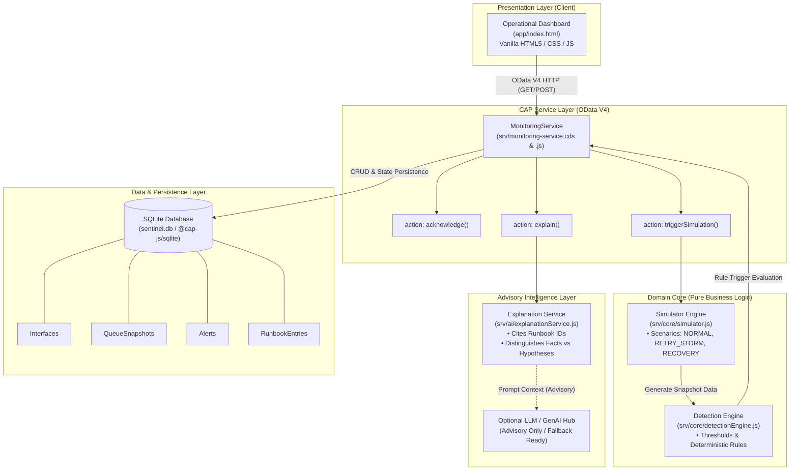
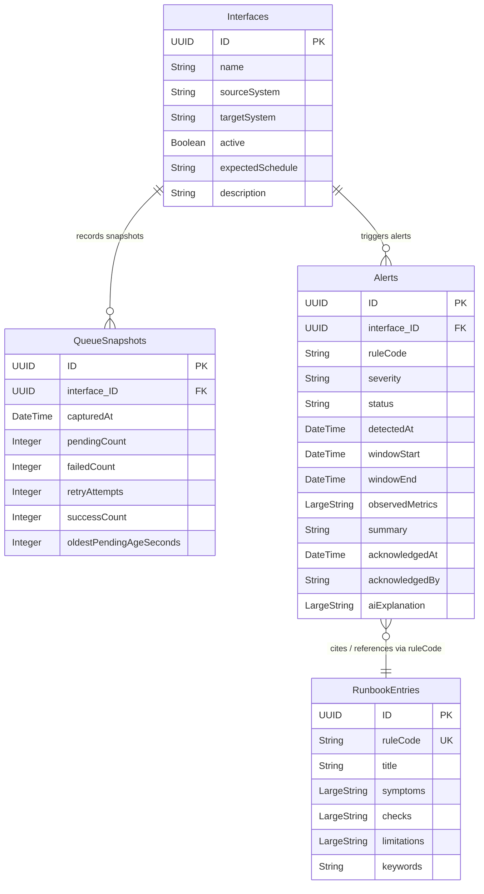
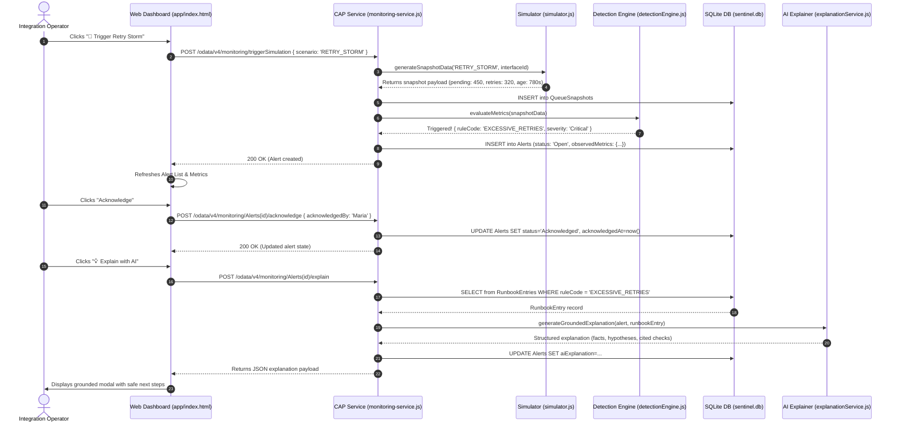

# 🛡️ Retry Storm Sentinel — System Architecture

> **Core Philosophy:** *"Rules detect the pattern; AI explains the evidence. AI does not make the detection decision and does not perform automatic remediation."*

---

## 1. System Overview

**Retry Storm Sentinel** is an integration monitoring and resilience advisory prototype built on the **SAP Cloud Application Programming Model (CAP)** with Node.js, CDS, OData V4, and SQLite.

In enterprise integration landscapes (e.g., SAP Integration Suite, SAP S/4HANA, order management platforms), message processing can fail due to transient network disruptions, destination unreachability, or bad payloads. While automatic retries are essential for transient faults, improper retry policies combined with continuous incoming traffic trigger **Retry Storms**—cascading backlogs where processing delays mount and system recovery is inhibited.

Retry Storm Sentinel provides:
1. **Deterministic Rule-based Detection** of excessive retries, queue backlogs, and SLA breaches.
2. **Deterministic Synthetic Simulation** of normal, incident, and recovery traffic.
3. **Grounded AI Explanations** that cite curated runbook procedures without guessing or hallucinating root causes.
4. **Human-in-the-Loop Operational Lifecycle** with auditable alert acknowledgements.

---

## 2. High-Level Architecture Diagram

---

## 3. Component Breakdown

### 3.1 Presentation Layer ([app/index.html](file:///c:/Users/lumaa/OneDrive/Desktop/projects/Restorm/app/index.html))
- **Tech**: Vanilla HTML5, modern CSS3 (custom CSS variables, responsive grid, dark mode aesthetic), and ES6 JavaScript.
- **Responsibilities**:
  - Displays monitored integration cards with active status, queue size, and retry rates.
  - Houses interactive simulation control buttons to inject deterministic test scenarios (`NORMAL`, `RETRY_STORM`, `QUEUE_GROWTH`, `RECOVERY`).
  - Lists real-time active alerts with severity badges, timestamps, and detection summaries.
  - Provides one-click operator acknowledgement workflows.
  - Renders an AI Explanation modal displaying structured findings, observed facts, hypotheses, and cited runbook checks.

### 3.2 Service Layer ([srv/monitoring-service.cds](file:///c:/Users/lumaa/OneDrive/Desktop/projects/Restorm/srv/monitoring-service.cds) & [srv/monitoring-service.js](file:///c:/Users/lumaa/OneDrive/Desktop/projects/Restorm/srv/monitoring-service.js))
- **Tech**: SAP CAP (`@sap/cds` v9) `ApplicationService`.
- **Protocol**: OData V4.
- **Responsibilities**:
  - Exposes entity projections for `Interfaces`, `QueueSnapshots`, `Alerts`, and `RunbookEntries`.
  - Defines and dispatches custom actions:
    - `acknowledge(acknowledgedBy: String)`: Transitions alert status to `Acknowledged` and sets audit timestamps.
    - `explain()`: Generates grounded advisory recommendations using alert facts and matched runbook entries.
    - `triggerSimulation(scenario: String, interfaceId: UUID)`: Coordinates synthetic data generation and rule evaluation.

### 3.3 Domain Core ([srv/core/](file:///c:/Users/lumaa/OneDrive/Desktop/projects/Restorm/srv/core/))
- **[detectionEngine.js](file:///c:/Users/lumaa/OneDrive/Desktop/projects/Restorm/srv/core/detectionEngine.js)**:
  - Clean domain service containing deterministic threshold evaluations.
  - Configurable limits for:
    - `EXCESSIVE_RETRIES`: $\ge 100$ attempts $\rightarrow$ **Critical**
    - `QUEUE_GROWTH_LIMIT`: $\ge 200$ pending messages $\rightarrow$ **High**
    - `OLD_MESSAGE_AGE_SEC`: $\ge 600$ seconds (10 mins) $\rightarrow$ **High**
- **[simulator.js](file:///c:/Users/lumaa/OneDrive/Desktop/projects/Restorm/srv/core/simulator.js)**:
  - Generates repeatable, deterministic scenario snapshots without requiring live SAP integration connections.
  - Supports 5 canonical scenarios: `NORMAL`, `RETRY_STORM`, `QUEUE_GROWTH`, `PERSISTENT_BACKLOG`, and `RECOVERY`.

### 3.4 Advisory Intelligence Layer ([srv/ai/explanationService.js](file:///c:/Users/lumaa/OneDrive/Desktop/projects/Restorm/srv/ai/explanationService.js))
- **Tech**: Grounded context synthesis engine.
- **Responsibilities**:
  - Ingests the specific alert's `observedMetrics` and retrieves corresponding [RunbookEntries](file:///c:/Users/lumaa/OneDrive/Desktop/projects/Restorm/db/schema.cds#L53-L60) by `ruleCode`.
  - Structures output into standard incident response categories:
    1. **Summary**: Concise description of the rule breach.
    2. **Observed Facts**: Verified metrics extracted from the queue snapshot.
    3. **Hypotheses**: Possible explanations explicitly flagged as unproven theories.
    4. **Recommended Checks**: Safe, read-only diagnostic steps prioritized for operators.
    5. **Cited Runbook IDs**: Traceability link to approved organization runbooks.
    6. **Limitations**: Explicit disclaimer of what queue metrics cannot prove.

### 3.5 Persistence Layer ([db/schema.cds](file:///c:/Users/lumaa/OneDrive/Desktop/projects/Restorm/db/schema.cds) & [db/data/](file:///c:/Users/lumaa/OneDrive/Desktop/projects/Restorm/db/data/))
- **Tech**: CDS definitions compiled to local SQLite (`sentinel.db`) via `@cap-js/sqlite`.
- **Entities**:
  - `Interfaces`: Monitored logical integration channels.
  - `QueueSnapshots`: Point-in-time metrics captures (pending count, retries, failures, oldest message age).
  - `Alerts`: Audit-ready alert records with severity, status, timestamps, and observed metric JSON payloads.
  - `RunbookEntries`: Standard operating procedures, symptoms, limitations, and diagnostic instructions.

---

## 4. Entity Relationship Diagram (ERD)

---

## 5. End-to-End Simulation & Incident Flow

---

## 6. Key Architecture Decisions & Guardrails

| Decision Area | Architectural Choice | Rationale |
|---|---|---|
| **Detection Authority** | Pure deterministic rules ([detectionEngine.js](file:///c:/Users/lumaa/OneDrive/Desktop/projects/Restorm/srv/core/detectionEngine.js)) | AI models can hallucinate or introduce non-deterministic latency. Detection must be 100% predictable and testable. |
| **AI Role** | Read-only advisory explanation ([explanationService.js](file:///c:/Users/lumaa/OneDrive/Desktop/projects/Restorm/srv/ai/explanationService.js)) | Generative AI is strictly used to translate metrics and synthesize runbook steps into plain-English advice. |
| **No Auto-Remediation** | Explicitly out of scope | Automatically dropping messages, rerouting queues, or terminating endpoints in enterprise integrations risks data loss. |
| **Database Strategy** | Local SQLite for MVP development | Keeps local development lightweight with zero cloud dependency; migration to SAP HANA Cloud is a non-breaking configuration switch in CAP. |
| **Auditability** | Explicit fields for `acknowledgedAt`, `acknowledgedBy`, `observedMetrics` | Enterprise operations require a clean audit trail showing who verified each incident and the exact metric values at detection time. |
