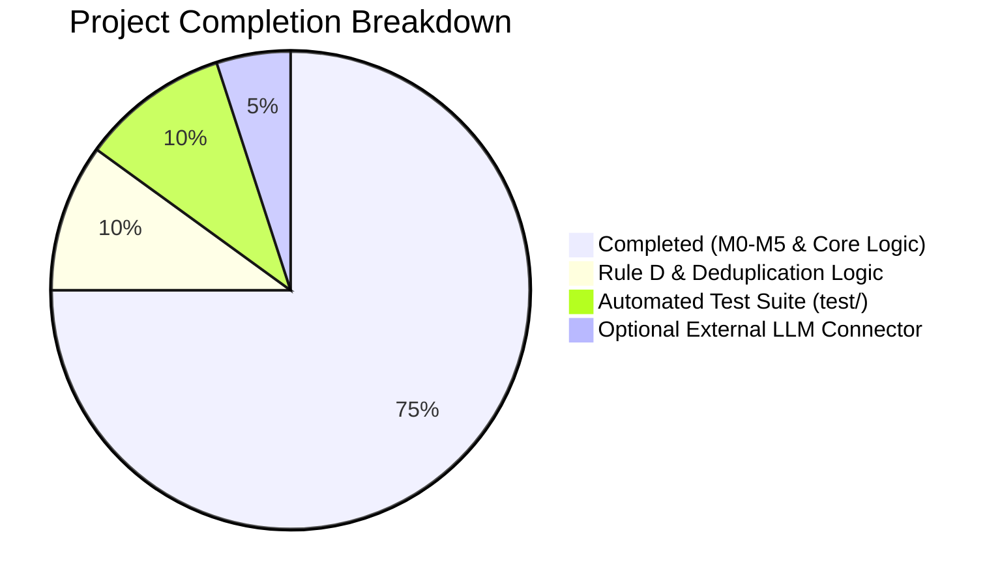

# 📊 Current Status Analysis & Gap Assessment

> **Date:** October 2026  
> **Reference Document:** [Retry_Storm_Sentinel_Master_Project_Document.md](file:///c:/Users/lumaa/OneDrive/Desktop/projects/Restorm/Retry_Storm_Sentinel_Master_Project_Document.md)  
> **Evaluator:** Antigravity AI Pair Programmer

---

## 1. Executive Summary

A comprehensive code audit of the **Retry Storm Sentinel** workspace indicates that **significant core progress has been made**, completing the functional backbone of the prototype (**Milestones M0 through M5, with foundational M6 implemented**). 

The repository contains a working SAP CAP backend, an OData V4 service with custom actions, a deterministic simulator and rule engine, and an operational web dashboard. 

The application satisfies the principal design philosophy: **Rules detect the pattern; AI explains the evidence.**

---

## 2. Component-by-Component Implementation Audit

### 2.1 Persistence & Data Model (`db/`)
| Specification Requirement | Implementation | Status | Notes |
|---|---|:---:|---|
| `Interfaces` entity | [db/schema.cds:L8-L17](file:///c:/Users/lumaa/OneDrive/Desktop/projects/Restorm/db/schema.cds#L8-L17) | ✅ Complete | Uses `cuid` & `managed`. Includes compositions to snapshots & alerts. |
| `QueueSnapshots` entity | [db/schema.cds:L22-L30](file:///c:/Users/lumaa/OneDrive/Desktop/projects/Restorm/db/schema.cds#L22-L30) | ✅ Complete | Captures pending, failed, retry, success, and oldest age. |
| `Alerts` entity | [db/schema.cds:L35-L48](file:///c:/Users/lumaa/OneDrive/Desktop/projects/Restorm/db/schema.cds#L35-L48) | ✅ Complete | Contains ruleCode, severity, status, timestamps, JSON `observedMetrics`, and audit fields. |
| `RunbookEntries` entity | [db/schema.cds:L53-L60](file:///c:/Users/lumaa/OneDrive/Desktop/projects/Restorm/db/schema.cds#L53-L60) | ✅ Complete | Includes symptoms, checks, limitations, and keywords. |
| Seed CSV Data | [db/data/](file:///c:/Users/lumaa/OneDrive/Desktop/projects/Restorm/db/data/) | ✅ Complete | Seed CSVs for Interfaces and RunbookEntries load cleanly on deploy. |

---

### 2.2 Service & API Layer (`srv/`)
| Specification Requirement | Implementation | Status | Notes |
|---|---|:---:|---|
| OData V4 Service Definition | [srv/monitoring-service.cds](file:///c:/Users/lumaa/OneDrive/Desktop/projects/Restorm/srv/monitoring-service.cds) | ✅ Complete | Projections on all 4 domain entities. |
| `acknowledge` action | [srv/monitoring-service.js:L15-L29](file:///c:/Users/lumaa/OneDrive/Desktop/projects/Restorm/srv/monitoring-service.js#L15-L29) | ✅ Complete | Validates alert existence, updates status to `Acknowledged`, sets timestamp and user. |
| `explain` action | [srv/monitoring-service.js:L32-L43](file:///c:/Users/lumaa/OneDrive/Desktop/projects/Restorm/srv/monitoring-service.js#L32-L43) | ✅ Complete | Retrieves alert and runbook entry, generates grounded explanation, persists to DB. |
| `triggerSimulation` action | [srv/monitoring-service.js:L46-L87](file:///c:/Users/lumaa/OneDrive/Desktop/projects/Restorm/srv/monitoring-service.js#L46-L87) | ✅ Complete | Generates snapshot via simulator, persists, runs detection rules, creates alerts. |

---

### 2.3 Core Domain Logic (`srv/core/`)
| Specification Requirement | Implementation | Status | Notes |
|---|---|:---:|---|
| Synthetic Scenario Generator | [srv/core/simulator.js](file:///c:/Users/lumaa/OneDrive/Desktop/projects/Restorm/srv/core/simulator.js) | ✅ Complete | Covers 5 scenarios: `NORMAL`, `RETRY_STORM`, `QUEUE_GROWTH`, `PERSISTENT_BACKLOG`, `RECOVERY`. |
| Rule A: Excessive Retries | [srv/core/detectionEngine.js:L15-L22](file:///c:/Users/lumaa/OneDrive/Desktop/projects/Restorm/srv/core/detectionEngine.js#L15-L22) | ✅ Complete | Triggers Critical when `retryAttempts >= 100`. |
| Rule B: Queue Growth | [srv/core/detectionEngine.js:L24-L31](file:///c:/Users/lumaa/OneDrive/Desktop/projects/Restorm/srv/core/detectionEngine.js#L24-L31) | ✅ Complete | Triggers High when `pendingCount >= 200`. |
| Rule C: Old Message Age | [srv/core/detectionEngine.js:L33-L40](file:///c:/Users/lumaa/OneDrive/Desktop/projects/Restorm/srv/core/detectionEngine.js#L33-L40) | ✅ Complete | Triggers High when `oldestPendingAgeSeconds >= 600`. |
| Rule D: Recovery Stalled | *Not yet implemented* | ⚠️ Pending | Needs logic to check whether queue drains following a recovery state. |
| Alert Deduplication / Cooldown | *Not yet implemented* | ⚠️ Pending | Multiple simulation clicks create new alerts rather than updating existing open alerts. |

---

### 2.4 Advisory Intelligence Layer (`srv/ai/`)
| Specification Requirement | Implementation | Status | Notes |
|---|---|:---:|---|
| Grounded Rule-to-Runbook Matching | [srv/ai/explanationService.js](file:///c:/Users/lumaa/OneDrive/Desktop/projects/Restorm/srv/ai/explanationService.js) | ✅ Complete | Safely parses metrics, retrieves runbook, structures facts, hypotheses, and checks. |
| Strict Citation of Runbook IDs | [srv/ai/explanationService.js:L23](file:///c:/Users/lumaa/OneDrive/Desktop/projects/Restorm/srv/ai/explanationService.js#L23) | ✅ Complete | Outputs `citedRunbookIds` referencing persistent catalog UUIDs. |
| Clear Uncertainty & Disclaimers | [srv/ai/explanationService.js:L24-L26](file:///c:/Users/lumaa/OneDrive/Desktop/projects/Restorm/srv/ai/explanationService.js#L24-L26) | ✅ Complete | States limitations: metrics describe queue state, not proven root causes. |
| Optional External LLM Integration | *Not yet integrated* | ⏳ Optional (P1) | Currently uses deterministic grounded synthesis. Ready for Gemini API or SAP GenAI Hub client integration. |

---

### 2.5 Presentation Layer (`app/`)
| Specification Requirement | Implementation | Status | Notes |
|---|---|:---:|---|
| Operational Dashboard | [app/index.html](file:///c:/Users/lumaa/OneDrive/Desktop/projects/Restorm/app/index.html) | ✅ Complete | Rich dark UI with live cards, control buttons, alert table, modal, and log. |
| Interactive Simulation Control | [app/index.html:L129-L135](file:///c:/Users/lumaa/OneDrive/Desktop/projects/Restorm/app/index.html#L129-L135) | ✅ Complete | One-click triggers for all scenarios. |
| In-browser Alert Acknowledgement | [app/index.html:L186-L198](file:///c:/Users/lumaa/OneDrive/Desktop/projects/Restorm/app/index.html#L186-L198) | ✅ Complete | Dispatches OData action and updates UI state dynamically. |
| AI Explanation Viewer Modal | [app/index.html:L200-L224](file:///c:/Users/lumaa/OneDrive/Desktop/projects/Restorm/app/index.html#L200-L224) | ✅ Complete | Displays formatted hypotheses and recommended checks. |

---

## 3. Identified Gaps & Technical Opportunities

1. **Rule D (Recovery Stalled Detection):**
   - *Requirement:* Section 10 of master document outlines detecting when pending messages fail to drain after downstream availability returns.
   - *Current State:* Recovery scenario exists in the simulator, but no rule checks if pending queue fails to decrease over successive snapshots.

2. **Alert Deduplication / Cooldown:**
   - *Requirement:* Section 10 notes: *"Add a cooldown or deduplication rule so the app does not create a new alert every polling cycle for the same ongoing incident."*
   - *Current State:* Triggering `RETRY_STORM` multiple times creates duplicate open alerts for the same interface.

3. **Automated Testing Suite (`test/`):**
   - *Requirement:* Section 16 defines scenario acceptance tests T1 through T8.
   - *Current State:* No `test/` directory exists yet. Adding `@sap/cds/test` with automated assertions will make the project enterprise-ready.

4. **External LLM Provider Option:**
   - *Requirement:* Section 14 provides the prompt template for GenAI explanations.
   - *Current State:* Grounded runbook synthesis is working offline. Adding an optional adapter for Google Gemini or SAP Generative AI Hub with graceful fallback will complete Milestone 6.

---

## 4. Recommended Next Action Plan

To bring the project to 100% completion against the master specification:

1. **Sprint 1 (Rule Engine Polish):**
   - Add alert deduplication in [srv/monitoring-service.js](file:///c:/Users/lumaa/OneDrive/Desktop/projects/Restorm/srv/monitoring-service.js) (check if an open alert with same `ruleCode` exists for the interface; update `windowEnd` and `observedMetrics` instead of creating duplicates).
   - Implement Rule D (`RECOVERY_STALLED`) in [srv/core/detectionEngine.js](file:///c:/Users/lumaa/OneDrive/Desktop/projects/Restorm/srv/core/detectionEngine.js).

2. **Sprint 2 (Test Suite Creation):**
   - Scaffold `test/` directory.
   - Implement functional tests for scenario evaluations (T1 Normal, T2 Retry Storm, T3 Queue Growth, T5 Recovery, T6 Backlog).
   - Add `npm test` script to `package.json`.

3. **Sprint 3 (Advisory AI Enhancement):**
   - Create an optional LLM client module in `srv/ai/llmClient.js` with structured system prompt and strict schema output.
   - Implement automatic fallback to deterministic synthesis if API keys are absent.
