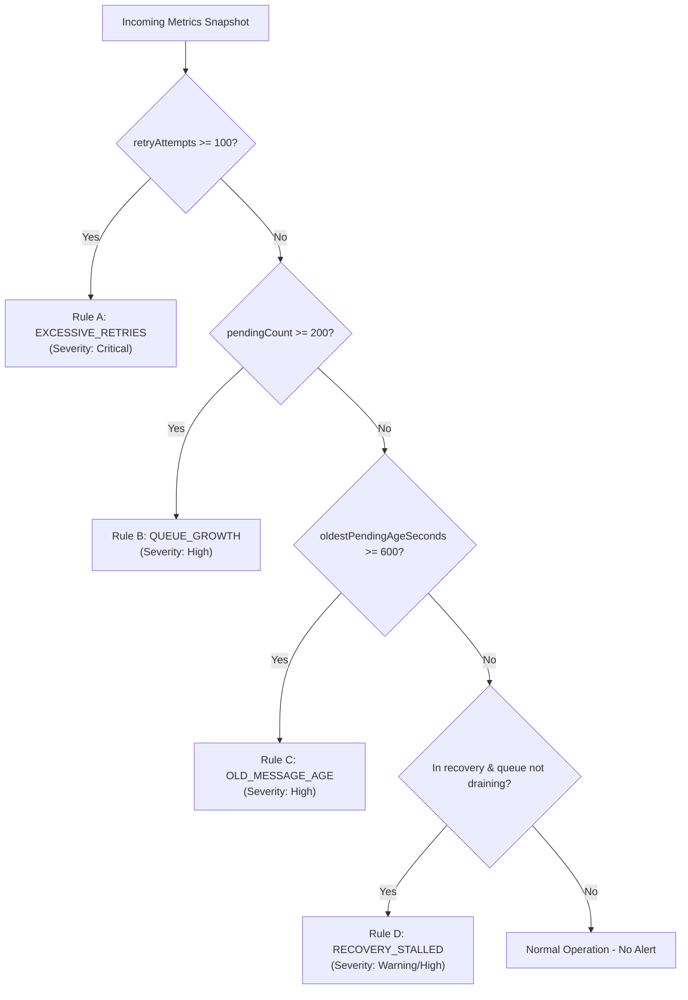

# 📏 Detection Rules & Runbook Specification

> **Guiding Principle:** Deterministic rules evaluate verified numerical metrics. Curated runbooks ensure investigation recommendations are safe, standard, and auditable.

---

## 1. Deterministic Detection Rules

Detection in **Retry Storm Sentinel** is strictly separated from AI inference. The detection engine evaluates point-in-time metrics against explicit thresholds to generate alerts.



---

## 2. Rule Threshold Matrix

| Rule Code | Monitored Metric | Threshold | Default Severity | Description / Risk |
|---|---|:---:|:---:|---|
| **`EXCESSIVE_RETRIES`** | `retryAttempts` | $\ge 100$ | **Critical** | Rapid retry cycling causing CPU/connection exhaustion on sender or target. |
| **`QUEUE_GROWTH`** | `pendingCount` | $\ge 200$ | **High** | Inflow exceeds consumption capacity; growing risk of buffer exhaustion. |
| **`OLD_MESSAGE_AGE`** | `oldestPendingAgeSeconds`| $\ge 600$ (10 min) | **High** | SLA breached; individual messages stuck or deadlocked in processing loop. |
| **`RECOVERY_STALLED`** | $\Delta\text{pendingCount}$ | $\Delta \le 0$ after recovery | **Warning** | Target system reported online, but queue draining has stalled or is backlogged. |

### Configuration Reference ([srv/core/detectionEngine.js](file:///c:/Users/lumaa/OneDrive/Desktop/projects/Restorm/srv/core/detectionEngine.js))
```javascript
const THRESHOLDS = {
    EXCESSIVE_RETRIES: 100,      // Max retry attempts per evaluation interval
    QUEUE_GROWTH_LIMIT: 200,     // Total backlog limit before growth warning
    OLD_MESSAGE_AGE_SEC: 600     // 10 minutes max age before SLA alert
};
```

---

## 3. Curated Runbook Catalog

Runbooks are curated, reviewed operational standard operating procedures stored in [db/data/sap.retrysentinel-RunbookEntries.csv](file:///c:/Users/lumaa/OneDrive/Desktop/projects/Restorm/db/data/sap.retrysentinel-RunbookEntries.csv). AI explanations must cite these specific records.

### Catalog Summary

#### Entry 1: Downstream Destination Outage
- **Rule Code:** `EXCESSIVE_RETRIES`
- **Title:** Downstream Service Unavailable / Connection Exhaustion
- **Symptoms:** Sudden surge in HTTP 500, 502, 503, or 504 responses; rapid retry escalation; pending queue compounding rapidly.
- **Safe Checks:**
  1. Check target endpoint health and network latency via SAP Cloud Integration Connectivity tests.
  2. Inspect whether the receiver has entered rate-limiting (HTTP 429) mode.
  3. Verify OAuth/mTLS credential validity and certificate expiration dates.
- **Limitations:** Queue metrics cannot identify whether the failure is DNS resolution, firewall drop, or backend crash.

#### Entry 2: Processing Bottleneck / Slow Consumer
- **Rule Code:** `QUEUE_GROWTH`
- **Title:** Consumer Backpressure / Throughput Saturation
- **Symptoms:** High inflow of incoming business documents; pending queue steadily increasing while failure rate remains low or moderate.
- **Safe Checks:**
  1. Check worker thread pool utilization and maximum concurrent consumers in SAP Cloud Integration / message broker.
  2. Review database lock wait times or long-running database transactions in target ERP (SAP S/4HANA).
  3. Verify whether scheduled batch jobs or bulk interfaces are competing for worker threads.
- **Limitations:** Growth indicates consumption imbalance, not whether the slow performance is caused by CPU, I/O, or external locking.

#### Entry 3: Poison Message / Stalled Processing
- **Rule Code:** `OLD_MESSAGE_AGE`
- **Title:** Poison Pill Message or Deadlock in Queue Head
- **Symptoms:** Oldest message age breaches 10+ minutes while newer messages may either bypass or be blocked behind head-of-line blocking.
- **Safe Checks:**
  1. Inspect the payload schema and XML/JSON validity of the oldest unacknowledged message.
  2. Verify whether target ERP custom BAPI or exit logic is throwing an unhandled exception or hanging indefinitely.
  3. Check if the message can be safely quarantined to a Dead Letter Queue (DLQ) after manual validation.
- **Limitations:** Age metrics verify that a message has not completed, but cannot prove if it was abandoned or is actively waiting on an external lock.

---

## 4. AI Guardrails & Prompt Template

When generating incident explanations, the advisory layer adheres to strict safety constraints:

1. **Advisory Only**: AI output is strictly read-only recommendations. No automated script execution.
2. **Grounding in Evidence**: The model is provided only the observed metrics and matching runbook entries.
3. **No Hallucinated Proof**: Hypotheses must be labeled as unverified possibilities.
4. **Citations Required**: All recommended checks must cite the corresponding `RunbookEntry.ID`.

### Master Prompt Specification
```text
You are an assistant for integration support engineers.

Use only the supplied alert facts and runbook entries. 
Do not claim a root cause unless the evidence proves it. 
Separate observed facts from possible explanations. 
Recommend safe read-only investigation steps first. 
Do not execute actions or recommend deleting messages or changing production configuration without human review. 
If the evidence is insufficient, say what is missing. 
Cite the runbook entry IDs supporting each recommendation.

Return JSON:
{
  "summary": "...",
  "observedFacts": {...},
  "possibleHypotheses": [...],
  "recommendedChecks": [...],
  "citedRunbookIds": [...],
  "limitations": "..."
}
```
