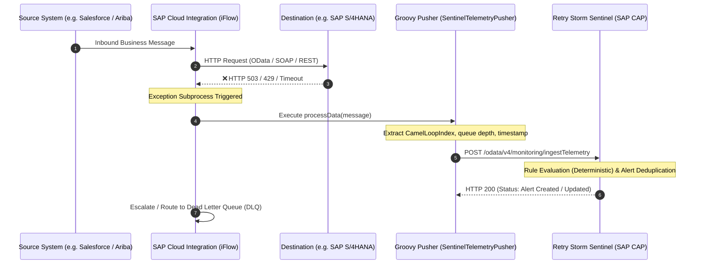

# SAP Cloud Integration (CPI) — Telemetry Ingestion Guide

## Executive Overview
**Retry Storm Sentinel** protects enterprise landscapes from catastrophic retry storms and queue exhaustion. This guide details how to connect **SAP Integration Suite (Cloud Integration / CPI)** iFlows directly to Sentinel's external ingestion API (`POST /odata/v4/monitoring/ingestTelemetry`).

By embedding a lightweight, zero-dependency Groovy script into your iFlow Exception Subprocesses, CPI automatically reports retry counts, backpressure, and destination failure codes without blocking business message processing.

---

## 1. Architecture & End-to-End Data Flow



---

## 2. Telemetry Ingestion API Specification

### Endpoint Details
- **Method:** `POST`
- **Path:** `/odata/v4/monitoring/ingestTelemetry`
- **Content-Type:** `application/json`
- **Authentication:** `Basic Auth` or SAP BTP `OAuth 2.0 Bearer Token`
- **Required Roles:** `SimulatorAdmin` or `SupportOperator`

### Request Payload Schema
```json
{
  "interfaceId": "b1000000-0000-0000-0000-000000000001",
  "capturedAt": "2026-10-22T13:30:00.000Z",
  "pendingCount": 180,
  "failedCount": 42,
  "retryAttempts": 85,
  "successCount": 3,
  "oldestPendingAgeSeconds": 360
}
```

### Parameter Validation Rules
| Field | Type | Bounds | Description |
| :--- | :--- | :--- | :--- |
| `interfaceId` | UUID (string) | Valid active Interface ID | Registered integration channel |
| `capturedAt` | ISO-8601 Timestamp | Within ±60s clock skew | Measurement timestamp |
| `pendingCount` | Integer | `0` to `1,000,000` | Current queue size or in-flight backlog |
| `failedCount` | Integer | `0` to `1,000,000` | Failed attempts during window |
| `retryAttempts` | Integer | `0` to `1,000,000` | Re-transmission iterations |
| `successCount` | Integer | `0` to `1,000,000` | Successfully committed messages |
| `oldestPendingAgeSeconds` | Integer | `0` to `2,592,000` (30 days) | Age of oldest uncommitted message |

---

## 3. Step-by-Step SAP CPI Setup

### Step 1: Deploy Security Material in CPI
1. In the SAP Integration Suite Web UI, navigate to **Monitor** > **Manage Security Material**.
2. Click **Create** > **User Credentials** (for Basic Auth) or **OAuth2 Client Credentials** (for SAP BTP XSUAA).
   - **Name:** `SENTINEL_CREDENTIALS`
   - **User / Client ID:** Provided by your BTP service binding (`bob` or client ID).
   - **Password / Client Secret:** Set your secure credential.

### Step 2: Import the Reusable Groovy Script
1. Open your target iFlow in the **Design** view.
2. In the **Resources** tab, select **Scripts** > **Add** > **File**.
3. Upload [`docs/cpi/SentinelTelemetryPusher.groovy`](file:///c:/Users/lumaa/OneDrive/Desktop/projects/Restorm/docs/cpi/SentinelTelemetryPusher.groovy).

### Step 3: Add Exception Subprocess
1. In the iFlow canvas, drag an **Exception Subprocess** component into your Integration Process.
2. Inside the Exception Subprocess, add:
   - **Start Event (Error Start Event)**
   - **Script Step:** Point to `SentinelTelemetryPusher.groovy` and function `processData`.
   - **Request-Reply Step:** (HTTP Receiver Adapter)
     - **Address:** `{{SENTINEL_BASE_URL}}/odata/v4/monitoring/ingestTelemetry`
     - **HTTP Method:** `POST`
     - **Authentication:** `Basic` or `OAuth2 Client Credentials`
     - **Credential Name:** `SENTINEL_CREDENTIALS`
     - **Timeout (ms):** `3000` (Strict 3s timeout)
   - **End Event (Error End Event):** Preserves standard CPI escalation and DLQ handling.

### Step 4: Externalize Parameters
Externalize these properties in your iFlow configuration:
- `SENTINEL_BASE_URL`: Base URL of Sentinel (e.g. `https://<btp-host>.cfapps.eu10.hana.ondemand.com`)
- `SENTINEL_INTERFACE_ID`: UUID of the monitored interface in Sentinel.

---

## 4. Production Safety & Non-Functional Protections

1. **Zero External Dependencies:**
   The Groovy script uses exclusively standard Java and Groovy classes present in all SAP CPI runtime nodes.
2. **Circuit-Breaker Safety:**
   Telemetry delivery is wrapped in a top-level `try-catch`. If Sentinel is undergoing maintenance or temporarily unreachable, **the original business message is never dropped or corrupted**.
3. **Strict 3000ms Timeout:**
   Guarantees that monitoring requests cannot exhaust CPI worker execution threads or cause JMS transaction timeouts.

---

## 5. Local Verification via cURL

You can test the exact payload generated by the CPI Groovy script against your local Sentinel instance:

```bash
# Ingest critical retry surge from simulated SAP CPI iFlow:
curl -X POST http://localhost:4004/odata/v4/monitoring/ingestTelemetry \
  -u bob: \
  -H "Content-Type: application/json" \
  -d '{
    "interfaceId": "b1000000-0000-0000-0000-000000000001",
    "capturedAt": "'$(date -u +"%Y-%m-%dT%H:%M:%SZ")'",
    "pendingCount": 350,
    "failedCount": 140,
    "retryAttempts": 280,
    "successCount": 2,
    "oldestPendingAgeSeconds": 540
  }'
```

### Expected Response
```json
{
  "status": "Accepted",
  "interfaceId": "b1000000-0000-0000-0000-000000000001",
  "interfaceName": "Sales Orders to S/4HANA",
  "alertTriggered": true,
  "alertAction": "Created",
  "ruleCode": "EXCESSIVE_RETRIES",
  "severity": "Critical",
  "repeatCount": 1,
  "summary": "Alert [EXCESSIVE_RETRIES] created (Critical).",
  "message": "External Ingestion [Sales Orders to S/4HANA]: Snapshot saved & Alert [EXCESSIVE_RETRIES] created (Critical)."
}
```
