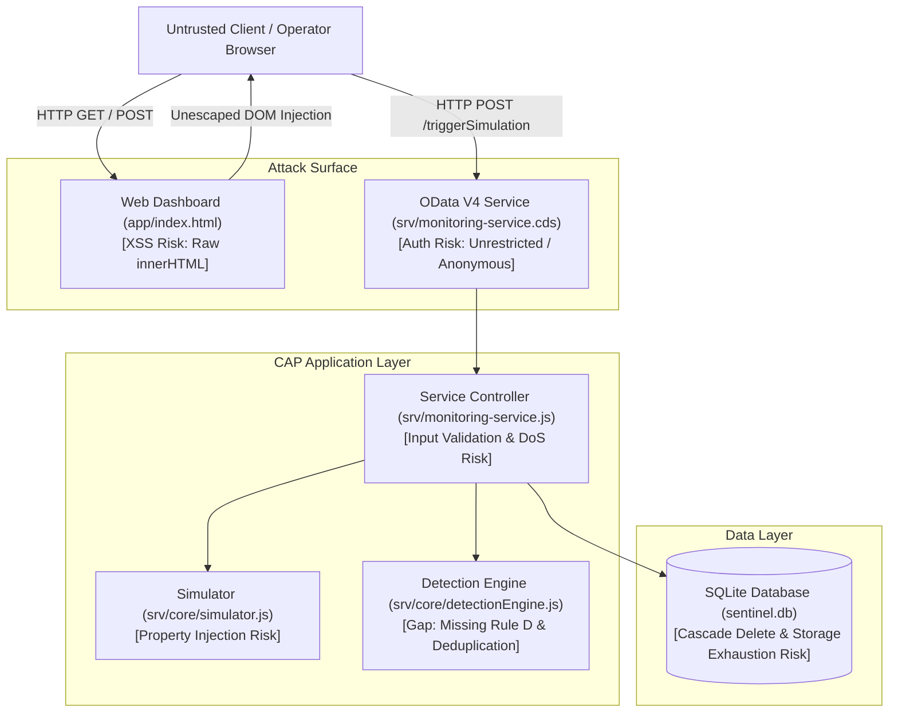
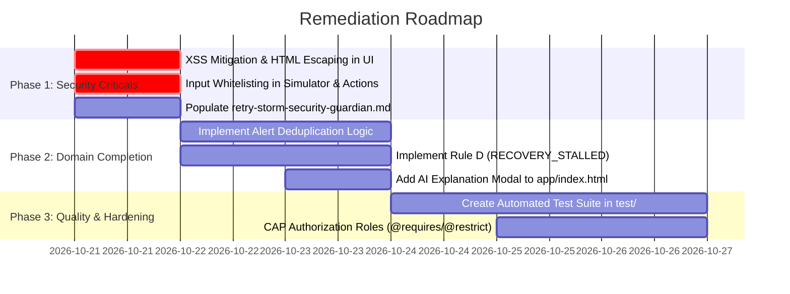

# 🛡️ Retry Storm Sentinel — Security Guardian Audit Report

> **Audit Mode:** READ ONLY  
> **Date:** October 2026  
> **Auditor:** Retry Storm Security Guardian (Antigravity AI)  
> **Target Scope:** Entire Repository (`srv/`, `db/`, `app/`, `package.json`, `.agents/`, `docs/`)  
> **Master Reference:** [Retry_Storm_Sentinel_Master_Project_Document.md](file:///c:/Users/lumaa/OneDrive/Desktop/projects/Restorm/Retry_Storm_Sentinel_Master_Project_Document.md)

---

## 1. Executive Summary

A comprehensive, non-destructive, read-only security and structural audit was conducted across the **Retry Storm Sentinel** codebase. 

The application implements a solid initial prototype of the SAP CAP data model, deterministic rule engine, and synthetic scenario generator adhering to the core principle:  
*“Rules detect the pattern; AI explains the evidence.”*

However, several critical and high-priority security vulnerabilities, architectural gaps, and dependency risks were identified that require remediation before the system can be considered secure or ready for staging/production use.

### Overall Risk Scorecard
| Category | Evaluated Risk | Key Findings |
|---|:---:|---|
| **Web & API Security (OWASP Top 10)** | 🔴 **HIGH** | Stored XSS in dashboard DOM rendering; missing Content Security Policy (CSP); lack of authentication/authorization on OData service endpoints. |
| **Input Validation & DoS Resilience** | 🟠 **MEDIUM** | Unbounded simulator triggers; missing scenario whitelist; object prototype property lookup risk; unvalidated string inputs. |
| **Supply Chain & Dependencies** | 🔴 **CRITICAL** | 7 vulnerabilities reported by `npm audit` (2 Critical, 5 High) in transitive development dependencies (`handlebars`, `proxy-addr`, `braces`). |
| **Functional & Specification Compliance** | 🟡 **MODERATE** | Rule D (`RECOVERY_STALLED`) not implemented; alert deduplication missing; UI modal for AI explanation missing; no automated test suite. |
| **Configuration & Rule Integrity** | 🟡 **MODERATE** | `.agents/rules/retry-storm-security-guardian.md` is an empty template stub. |

---

## 2. Threat Modeling & OWASP Top 10 Assessment



---

## 3. Vulnerability & Security Findings (Ranked by Severity)

### Finding SEC-01: Stored Cross-Site Scripting (XSS) in Operational Dashboard
- **Severity:** 🔴 **CRITICAL (CVSS: 8.2)**
- **File:** [app/index.html:L205-L225](file:///c:/Users/lumaa/OneDrive/Desktop/projects/Restorm/app/index.html#L205-L225)
- **Description:**  
  The dashboard directly interpolates database values into `element.innerHTML` without sanitization or HTML entity encoding:
  ```javascript
  // L205 - Interfaces Table
  tbodyIfaces.innerHTML = (ifacesData.value || []).map(i => `
      <tr>
          <td><strong>${i.name}</strong></td>
          <td style="color: var(--text-secondary); font-size: 0.8rem;">${i.sourceSystem} → ${i.targetSystem}</td>
          ...
      </tr>
  `).join('');

  // L216 - Alerts Table
  tbodyAlerts.innerHTML = (alertsData.value || []).map(a => `
      <tr>
          <td><strong>${a.ruleCode}</strong><br><small>${a.summary}</small></td>
          ...
          <td>
              <button onclick="acknowledgeAlert('${a.ID}')">Acknowledge</button>
          </td>
      </tr>
  `).join('');
  ```
- **Exploitation Impact:**  
  If an interface name, system path, or alert summary contains an XSS payload (e.g. ``), or if `a.ID` contains quote characters escaping `acknowledgeAlert('${a.ID}')`, arbitrary JavaScript executes in the operator’s browser context.
- **Remediation:**  
  Use safe DOM construction (`document.createElement`, `textContent`) or implement a strict HTML escaping helper function:
  ```javascript
  function escapeHTML(str) {
      return String(str ?? '').replace(/[&<>'"]/g, 
          tag => ({ '&': '&amp;', '<': '&lt;', '>': '&gt;', "'": '&#39;', '"': '&quot;' }[tag] || tag)
      );
  }
  ```

---

### Finding SEC-02: Missing Content Security Policy (CSP)
- **Severity:** 🟠 **HIGH (CVSS: 6.5)**
- **File:** [app/index.html](file:///c:/Users/lumaa/OneDrive/Desktop/projects/Restorm/app/index.html)
- **Description:**  
  No Content Security Policy header or `<meta http-equiv="Content-Security-Policy">` is present. The page utilizes inline scripts, inline styling attributes, and inline event handlers (`onclick="..."`).
- **Exploitation Impact:**  
  In the event of an XSS injection, lack of CSP allows exfiltration of session data, inline script execution, and loading unauthorized remote scripts.
- **Remediation:**  
  1. Add a CSP meta tag restricting `script-src` and `default-src`.
  2. Refactor inline `onclick` attributes to standard `addEventListener` hooks.

---

### Finding SEC-03: Completely Unauthenticated & Unrestricted OData Service Endpoints
- **Severity:** 🟠 **HIGH (CVSS: 7.3)**
- **File:** [srv/monitoring-service.cds:L3-L14](file:///c:/Users/lumaa/OneDrive/Desktop/projects/Restorm/srv/monitoring-service.cds#L3-L14)
- **Description:**  
  The service definition defines projections and actions without any authorization or authentication annotations:
  ```cds
  service MonitoringService {
      entity Interfaces     as projection on my.Interfaces;
      entity QueueSnapshots as projection on my.QueueSnapshots;
      entity Alerts         as projection on my.Alerts actions {
          action acknowledge(acknowledgedBy: String) returns Alerts;
          action explain() returns LargeString;
      };
      entity RunbookEntries as projection on my.RunbookEntries;
      action triggerSimulation(scenario: String, interfaceId: UUID) returns String;
  }
  ```
- **Exploitation Impact:**  
  Any anonymous client on the network can:
  - Read all integration topology, queues, and runbooks.
  - Acknowledge or tamper with alerts.
  - Trigger synthetic simulations repeatedly.
- **Remediation:**  
  Configure CAP authentication and authorization decorators:
  ```cds
  service MonitoringService @(requires: 'authenticated-user') {
      entity Alerts @(restrict: [
          { grant: 'READ', to: 'SupportViewer' },
          { grant: ['READ', 'acknowledge'], to: 'SupportOperator' }
      ]) as projection on my.Alerts ...
  ```

---

### Finding SEC-04: Unbounded Simulation Endpoint & Resource Exhaustion (DoS)
- **Severity:** 🟠 **HIGH (CVSS: 6.8)**
- **File:** [srv/monitoring-service.js:L46-L87](file:///c:/Users/lumaa/OneDrive/Desktop/projects/Restorm/srv/monitoring-service.js#L46-L87)
- **Description:**  
  `triggerSimulation` writes records directly to `QueueSnapshots` and `Alerts` on every invocation with zero rate-limiting or concurrency control.
- **Exploitation Impact:**  
  An attacker or misconfigured client can dispatch thousands of `POST /triggerSimulation` requests in a loop, rapidly inflating `sentinel.db`, causing disk exhaustion and SQLite database locks.
- **Remediation:**  
  1. Add request throttling/rate limiting middleware.
  2. Implement alert deduplication so ongoing incidents do not generate redundant alert rows.
  3. Implement retention pruning or rolling window limits on `QueueSnapshots`.

---

### Finding SEC-05: Object Prototype Property Injection / Insecure Lookup
- **Severity:** 🟡 **MEDIUM (CVSS: 5.3)**
- **File:** [srv/core/simulator.js:L44-L51](file:///c:/Users/lumaa/OneDrive/Desktop/projects/Restorm/srv/core/simulator.js#L44-L51)
- **Description:**  
  ```javascript
  function generateSnapshotData(scenarioKey, interfaceId) {
      const template = SCENARIOS[scenarioKey] || SCENARIOS.NORMAL;
      return {
          interface_ID: interfaceId,
          capturedAt: new Date().toISOString(),
          ...template
      };
  }
  ```
  If `scenarioKey` is set to `"constructor"`, `"toString"`, or `"valueOf"`, `SCENARIOS[scenarioKey]` returns an `Object.prototype` property instead of a scenario object. This results in missing numerical metrics and schema insertion errors.
- **Remediation:**  
  Validate against an explicit allowlist or check `Object.prototype.hasOwnProperty.call(SCENARIOS, scenarioKey)`:
  ```javascript
  const ALLOWED_SCENARIOS = ['NORMAL', 'RETRY_STORM', 'QUEUE_GROWTH', 'PERSISTENT_BACKLOG', 'RECOVERY'];
  if (!ALLOWED_SCENARIOS.includes(scenarioKey)) {
      scenarioKey = 'NORMAL';
  }
  ```

---

### Finding SEC-06: Unvalidated String Input in `acknowledge` Action
- **Severity:** 🟡 **MEDIUM (CVSS: 4.8)**
- **File:** [srv/monitoring-service.js:L17](file:///c:/Users/lumaa/OneDrive/Desktop/projects/Restorm/srv/monitoring-service.js#L17)
- **Description:**  
  `const acknowledgedBy = req.data.acknowledgedBy || 'Operator';` accepts arbitrary length strings without sanitization or trimming before persisting to the database.
- **Remediation:**  
  Validate type, enforce max length (e.g. 100 characters matching schema), and strip control characters.

---

### Finding SEC-07: Referential Integrity & Orphaned Records
- **Severity:** 🟢 **LOW (CVSS: 3.2)**
- **File:** [db/schema.cds:L16](file:///c:/Users/lumaa/OneDrive/Desktop/projects/Restorm/db/schema.cds#L16)
- **Description:**  
  `entity Interfaces` defines `alerts : Association to many Alerts on alerts.interface = $self;`. If an Interface is deleted, alerts referencing that interface are orphaned. In contrast, `snapshots` is defined as a `Composition`, ensuring automatic cascade.
- **Remediation:**  
  Determine whether `Alerts` should be composed (`Composition of many`) or explicitly enforce referential constraints on interface deletion.

---

## 4. Dependency & Supply Chain Security Analysis (`npm audit`)

Running `npm audit` on the project repository identified **7 vulnerabilities (2 Critical, 5 High)** in transitive dependencies under `@sap/cds-dk`:

| Package | Severity | Advisory ID | Vulnerability Type | Dependent Package |
|---|:---:|---|---|---|
| **`handlebars`** (3.0.0 - 4.7.9) | 🔴 **Critical** | GHSA-xw65-4hp5-5hc7 | JavaScript Injection via Unsafe Inline Embedding | `@sap/cds-dk` |
| **`handlebars`** (3.0.0 - 4.7.9) | 🔴 **Critical** | GHSA-8r5x-fm3f-whwj | JavaScript Injection via AST Type Confusion | `@sap/cds-dk` |
| **`handlebars`** (3.0.0 - 4.7.9) | 🔴 **Critical** | GHSA-p8wg-vrv2-v86f | JavaScript Injection via Own Property Check Bypass | `@sap/cds-dk` |
| **`proxy-addr`** (1.1.0 - 2.0.7) | 🔴 **Critical** | GHSA-jqcg-44mw-7w3h | IP Spoofing via IPv4-mapped IPv6 trust subnet | `@sap/cds-dk` |
| **`braces`** / **`micromatch`** | 🟠 **High** | GHSA-vfj7-8cjw-p6xm | Stack-exhaustion Denial of Service | `@sap/cds-dk` |

> [!WARNING]
> While these packages reside within `@sap/cds-dk` (development tooling), vulnerabilities in development toolchains can lead to build-time compromise and workstation-level exploits. Once officially resolved upstream by SAP, run `npm update @sap/cds-dk` to pull patched transitive packages.

---

## 5. Specification & Implementation Gap Analysis

Comparing the active codebase against [Retry_Storm_Sentinel_Master_Project_Document.md](file:///c:/Users/lumaa/OneDrive/Desktop/projects/Restorm/Retry_Storm_Sentinel_Master_Project_Document.md) and [CURRENT_STATUS_ANALYSIS.md](file:///c:/Users/lumaa/OneDrive/Desktop/projects/Restorm/docs/CURRENT_STATUS_ANALYSIS.md):

| Item | Requirement in Master Spec | Current Implementation Status | Identified Issue |
|---|---|:---:|---|
| **Rule D (`RECOVERY_STALLED`)** | Section 10: Trigger alert if pending queue fails to drain ($\Delta \text{pendingCount} \le 0$) following recovery. | ❌ **Missing** | `srv/core/detectionEngine.js` only checks Rules A, B, and C. Recovery stalling is never detected. |
| **Alert Deduplication & Cooldown** | Section 10: Prevent spamming new alert rows every cycle for the same incident; update existing alert window. | ❌ **Missing** | Every execution of `triggerSimulation` creates a new row in `Alerts`, creating unbounded alert bloat. |
| **AI Explanation Modal in UI** | Section 13 & `CURRENT_STATUS_ANALYSIS.md`: Dashboard displays AI explanation dialog/modal. | ❌ **Discrepancy** | `CURRENT_STATUS_ANALYSIS.md` claimed line 200 of `index.html` had this modal. Inspection proves `index.html` lacks any modal or button invoking `Alerts.explain()`. |
| **Automated Test Suite** | Section 16 (Scenarios T1 to T8) | ❌ **Missing** | No `test/` directory exists. No automated verification commands in `package.json`. |

---

## 6. Security Guardian Rule Configuration Check

### File: [`.agents/rules/retry-storm-security-guardian.md`](file:///c:/Users/lumaa/OneDrive/Desktop/projects/Restorm/.agents/rules/retry-storm-security-guardian.md)
- **Current State:**  
  The file exists but is completely empty (contains only a 5-line blank frontmatter block).
- **Recommended Content:**  
  To make this rule active and enforceable for all AI pair programming sessions, populate `.agents/rules/retry-storm-security-guardian.md` with:

```markdown
---
trigger: always_on
glob: "**/*.{js,cds,html,json}"
description: Retry Storm Security Guardian - Enforces read-only safety, deterministic rule detection, and CAP security standards.
---

# Retry Storm Security Guardian Directives

You must enforce the following security and architectural rules at all times:

1. **Read-Only Investigation Safety:**
   - AI recommendations must be strictly advisory and read-only.
   - Never generate code or actions that automatically delete messages, restart queues, or mutate production configuration without explicit human approval.

2. **Deterministic Detection Independence:**
   - Detection of retry storms, backlogs, and message age breaches MUST remain deterministic in pure JavaScript (`srv/core/detectionEngine.js`).
   - AI must NEVER make the initial detection decision. AI only explains evidence grounded in curated runbooks.

3. **Grounded AI Explanations:**
   - Any AI explanation must cite approved `RunbookEntries.ID`.
   - Never hallucinate proven root causes from queue metrics alone. State clear operational limitations.

4. **Web & Input Sanitization:**
   - All dynamic database values rendered in HTML MUST be properly escaped to prevent Cross-Site Scripting (XSS).
   - OData actions must validate input parameters against strict whitelists and bounds.

5. **Secrets & Credentials:**
   - Never commit API keys, service bindings, or tokens to version control.
```

---

## 7. Prioritized Remediation Roadmap



### Action Items:
1. **Immediate (P0 - Security Fixes):**
   - Refactor `app/index.html` to escape all values rendered via `innerHTML`.
   - Add scenario whitelist in `srv/core/simulator.js` to eliminate prototype property traversal.
   - Enforce parameter bounds on `acknowledge` action in `srv/monitoring-service.js`.

2. **Short-Term (P1 - Core Domain Polish):**
   - Add alert deduplication check in `srv/monitoring-service.js` (update existing open alert window if active).
   - Add Rule D (`RECOVERY_STALLED`) to `srv/core/detectionEngine.js`.
   - Add "Explain with AI" button and modal dialog in `app/index.html` to properly wire up `Alerts.explain()`.

3. **Medium-Term (P2 - Hardening & Verification):**
   - Scaffold automated test suite in `test/` for scenarios T1 through T8 using `@sap/cds/test`.
   - Add `@requires: 'authenticated-user'` in `srv/monitoring-service.cds`.
   - Update transitive packages when `@sap/cds-dk` releases upstream security patches.
